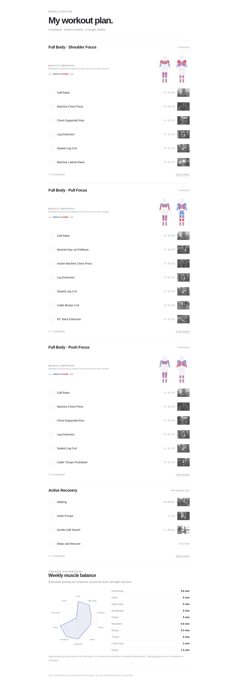

# Workout Plan Template

A ready-made, minimalist workout checklist site for desktop and mobile. It includes grayscale exercise images, front/back muscle SVG heatmaps and a weekly working-set radar chart.

**Live example:** https://hmetgundogdu.github.io/my-workout-program/

## Preview

[Open the live demo](https://hmetgundogdu.github.io/my-workout-program/) · [Social preview image](./assets/social-preview.png)

The preview screenshots are generated from the actual site by [GitHub Actions](./.github/workflows/preview.yml) whenever the application changes.

**Template version:** v1.2.0 (also visible in the page header)

## Install as an app (PWA)

The website supports installation as a Progressive Web App (PWA), including a standalone home-screen icon, manifest, and offline caching of the core interface and workout program. Progress stays in browser-local storage on that installation.

- **Android / supported desktop browsers:** open the live site and select **Install app** when offered, or use the browser's installation menu.
- **iPhone / iPad:** open the site in Safari, then use **Share → Add to Home Screen** (installation prompt support differs by browser).
- The exercise thumbnails are hosted by Free Exercise DB; they are not included in the offline app shell and may not appear without a connection.
- Workouts remain locally stored; they are not synced between the browser tab and an installed-app storage context, or across devices.
- Updates to the template's application files are fetched by the service worker on subsequent visits. The **coding-agent upstream update workflow** is separate and still requires user approval before modifying anyone's fork.

PWA sources: [manifest](./manifest.webmanifest), [service worker](./sw.js), [app icon](./assets/app-icon.svg) and [icon generation workflow](./.github/workflows/pwa-icons.yml).

## Create your own workout site

**Do not ask an agent to recreate the site from scratch.** Fork or copy this repository. All UI styling, anatomy figures, checklist logic and charts are already implemented.

1. Copy or fork the full repository.
2. Tell your coding agent to read [SKILL.md](./SKILL.md).
3. Supply your preferred exercises, sets, reps and session names.
4. Have the agent edit **only [workout-data.js](./workout-data.js)**.
5. Set **Settings → Pages → Source: GitHub Actions** in your copy. The existing workflow deploys automatically when you push to `main`.

**Example prompt:**

> Use this repository's SKILL.md and existing code as an exact template. Do not redesign the site. Customize only workout-data.js using my routine, including matched exercise illustrations and muscle coefficients. Validate the chart and publish my own copy on GitHub Pages.

## Updating a copied template

A coding agent can check the [original template repository](https://github.com/hmetgundogdu/my-workout-program) for updates, compare versions and changes, and **ask for your permission before applying them**. The update process must preserve your own `workout-data.js`, custom site URLs, and existing progress where possible.

The version shown on the page comes from [template-version.js](./template-version.js), and tracks changes to the shared UI/features rather than your own workout program. It does not automatically update from the browser.

**Ask your agent:**

> Check my copy against the official my-workout-program template. Tell me what changed, then ask before applying an update. Preserve my workout-data.js, custom settings, and existing workout progress. Apply and deploy only after I approve.

See [SKILL.md](./SKILL.md) for the detailed comparison, backup, approval and merge procedure.

## Repository files

| File | Purpose |
| --- | --- |
| [manifest.webmanifest](./manifest.webmanifest) | Install name, scope, display mode and icon references |
| [sw.js](./sw.js) | Offline app-shell cache scoped to this installation |
| [template-version.js](./template-version.js) | Displayed template version, updated after an approved upstream release |
| [index.html](./index.html) | **Fixed renderer:** minimalist styling, checkbox logic, SVG body maps, radar, thumbnail layout |
| [workout-data.js](./workout-data.js) | **Editable routine:** sections, exercises, repetitions, image lookup and weighted-muscle estimates |
| [SKILL.md](./SKILL.md) | Instructions for other coding agents to reuse the exact existing implementation |
| [.github/workflows/pages.yml](./.github/workflows/pages.yml) | GitHub Pages deployment |

The application needs no framework or build step. Open `index.html` locally or publish through GitHub Pages. Unlike a separate fetched JSON file, the bundled `workout-data.js` is also compatible with ordinary file browsing.

Checkbox completion is saved to the current browser's `localStorage`. There is no account, online synchronization or telemetry. If you change the order of exercises on an existing live site, stored index-based checkmarks may need to be cleared or migrated.

Images use the [Free Exercise DB](https://github.com/yuhonas/free-exercise-db) collection and a common grayscale CSS treatment. Some equipment variants are approximations; verify the correct matching exercise. Muscle heatmaps and the radar describe *estimated set emphasis*, not measured muscle activation or guaranteed results.

## Consistency

The supplied renderer preserves the reference page's exact HTML/CSS/JS instead of leaving design choices to an agent. Rendering can still differ slightly by browser, screen size, or image availability. For major source-code changes, test visually at mobile and desktop widths.
